

  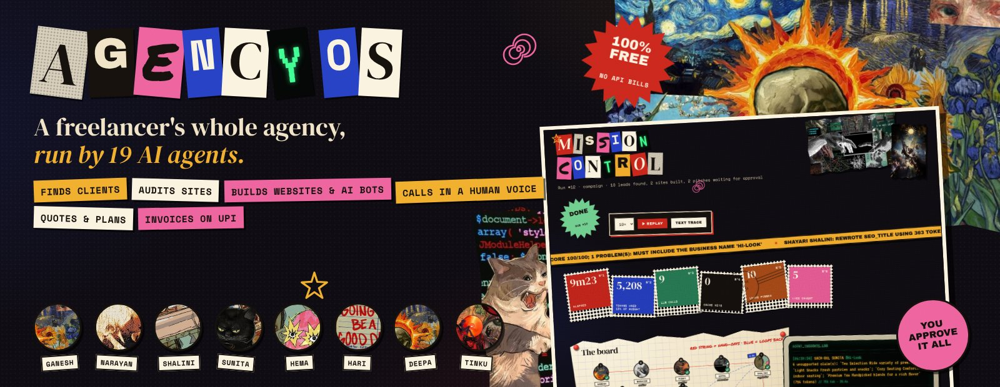

<h3 align="center">A freelancer's whole agency, run by 19 AI agents. The agents find your clients, build their new website, pitch it, call them, quote, plan the work and chase the payment. All of it, for you. You just approve.</h3>

  
  
  
  
  
  
  

  <a href="#watch-the-agents-work">Demo</a> ·
  <a href="#what-your-agency-does">Features</a> ·
  <a href="#meet-the-agency">Meet the agency</a> ·
  <a href="docs/HOW-IT-WORKS.md">How it works</a> ·
  <a href="#want-agencyos-contact-me">Contact</a>

  
  
  

---

Freelancers who sell websites spend most of their week **not** building: hunting for clients on Google Maps,
writing cold messages nobody answers, chasing advances, juggling deadlines. **AgencyOS hands all of that to a
team of AI agents**, each with a desk, a job and a funny Indian nickname, while you stay the boss (*Malik*).
Clients never see this dashboard: the agents reach them on WhatsApp, email and calls, and **nothing goes out
without your OK**.

It is **free to run** (free LLM tiers, OpenStreetMap, SQLite or a free PostgreSQL), works on **real businesses only**
(no demo data), and was built to **spend as few tokens as possible**: 10 of the 19 agents are plain code.

## Watch the agents work

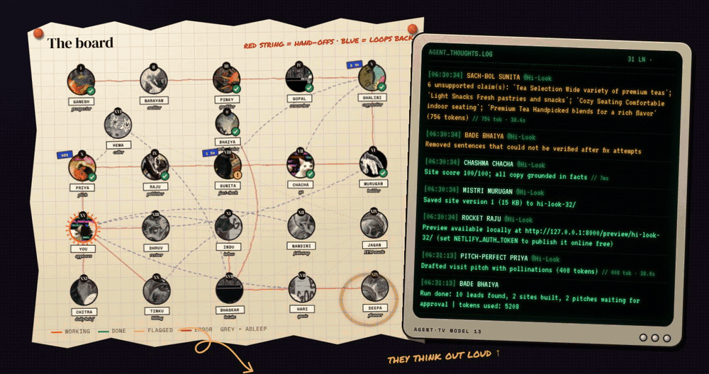

A real campaign replayed at 5× speed: Gully Ganesh finds 10 real cafés on OpenStreetMap, Paisa-Vasool Pinky picks the 2
worth a website, Shayari Shalini writes the copy, Chashma Chacha and Sach-Bol Sunita send it back when it invents things,
Mistri Murugan builds it, Pitch-Perfect Priya drafts the pitch. Whole run: **5,208 tokens**, 5 invented claims caught.

## What your agency does

<table>
<tr>
<td width="33%" valign="top"> <b>Finds clients</b> Real businesses from the map, every website audited on 20 checks, ranked by how badly they need you.</td>
<td width="33%" valign="top">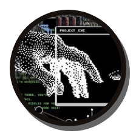 <b>Builds before it pitches</b> The agents build a fact-checked preview of the client's new website first, so their pitch is <i>"we already made it for you"</i>.</td>
<td width="33%" valign="top"> <b>Talks like a human</b> WhatsApp and email drafts, reply reading, polite follow-ups, and an AI voice caller in English, Tamil and Hindi.</td>
</tr>
<tr>
<td width="33%" valign="top">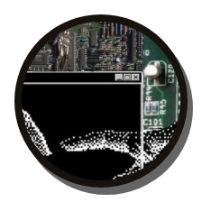 <b>Turns chats into gigs</b> Paste any client chat: scope, a price from your playbook, a plan around your week, a proposal.</td>
<td width="33%" valign="top">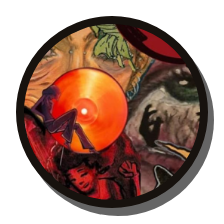 <b>Chases the money</b> Advance and final invoices with UPI links and QR codes, <i>"paid on GPay"</i> detection, payment confirmations.</td>
<td width="33%" valign="top">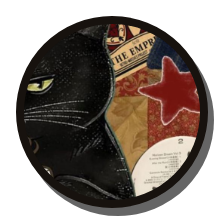 <b>Runs your day</b> Today's tasks, money to collect, warm leads to chase and messages waiting for your OK, on one page.</td>
</tr>
</table>

Websites are just the start: the playbooks also cover **AI chatbots, n8n automations, CRMs and ML models**.

### It builds the website before it pitches

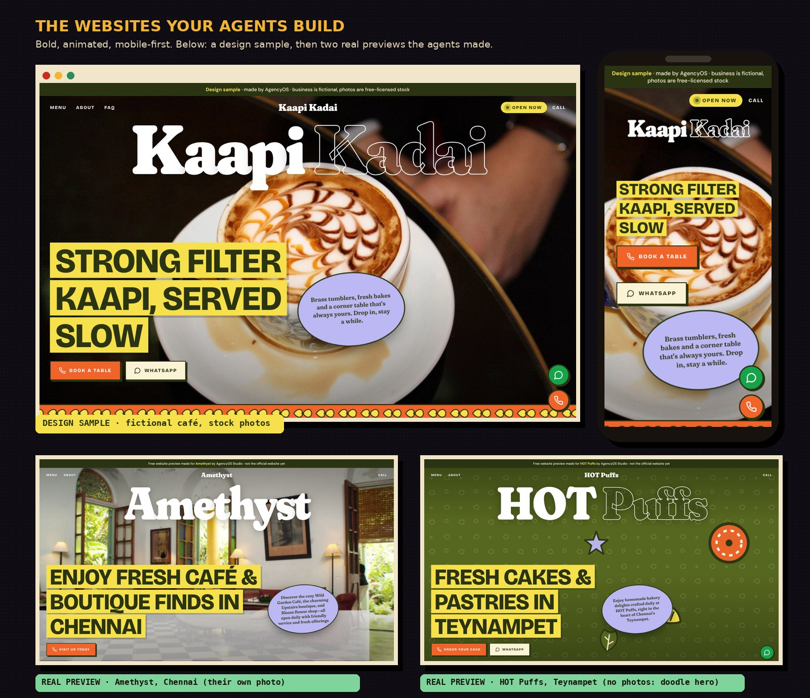

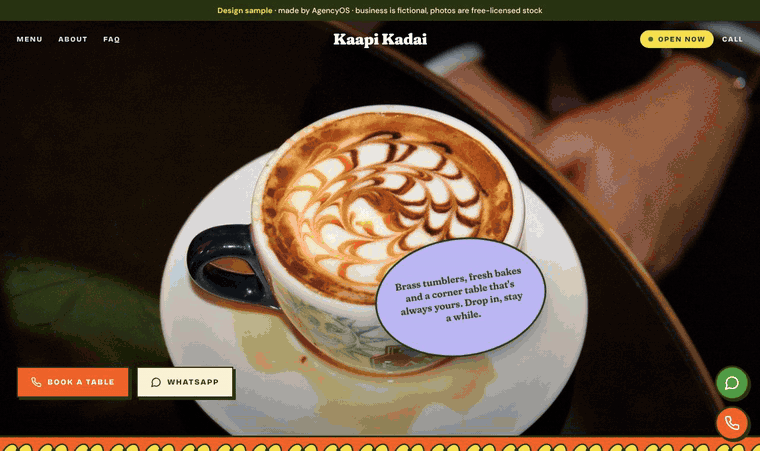 
The signature design in motion. <b>Kaapi Kadai is a design sample</b> (a fictional café with free-licensed stock photos); real previews use the business's own photos and facts, and fall back to illustrations when there are none.

Every preview uses the agency's **signature design**: a giant retro wordmark, highlight-block headlines, a hand-drawn
sticker, a scrolling ornament strip, menu cards, polaroids that drop in as you scroll, a live "open now" badge from the real
opening hours, and floating call and WhatsApp buttons. It stays fast and mobile-first, and scores the same on the 20 audit checks.

The Researcher turns the business's real website (or map listing) into verified facts, the Copywriter writes from those facts
only, and two checkers (rules, then an LLM whose complaints are themselves verified in code) strip anything invented.
Phone numbers, addresses and opening hours come from data, so the AI can't make them up.

### Mission Control: see every agent think

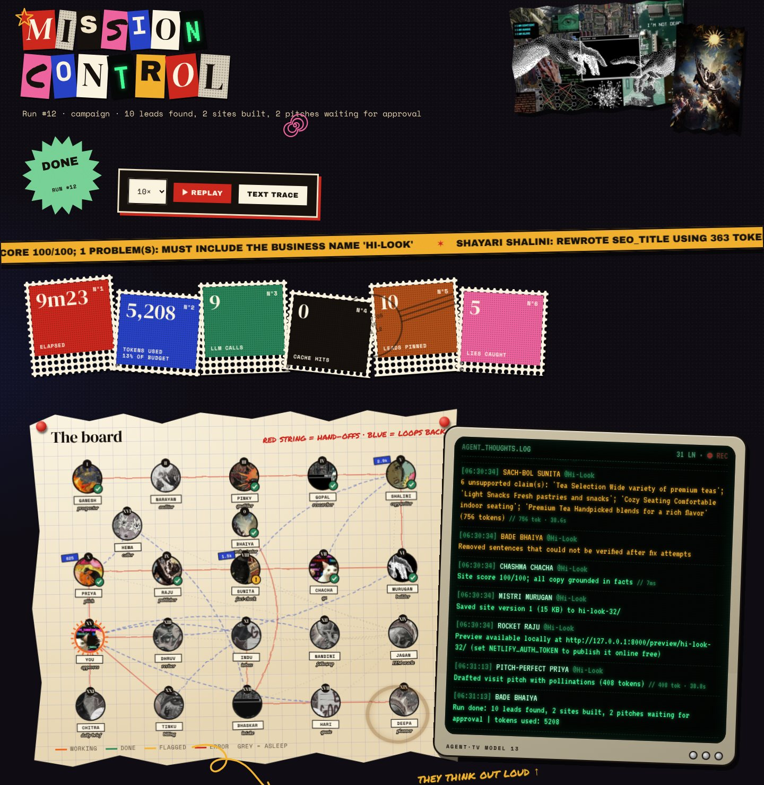

Every agent is a node on the board. It lights up while it works, turns green, amber or red, and throws data packets to the
next agent. The terminal types out what each one is thinking, the stamps count tokens, LLM calls and lies caught, and
the whole run can be replayed at 5, 10 or 25×.

<table>
<tr>
<td width="50%">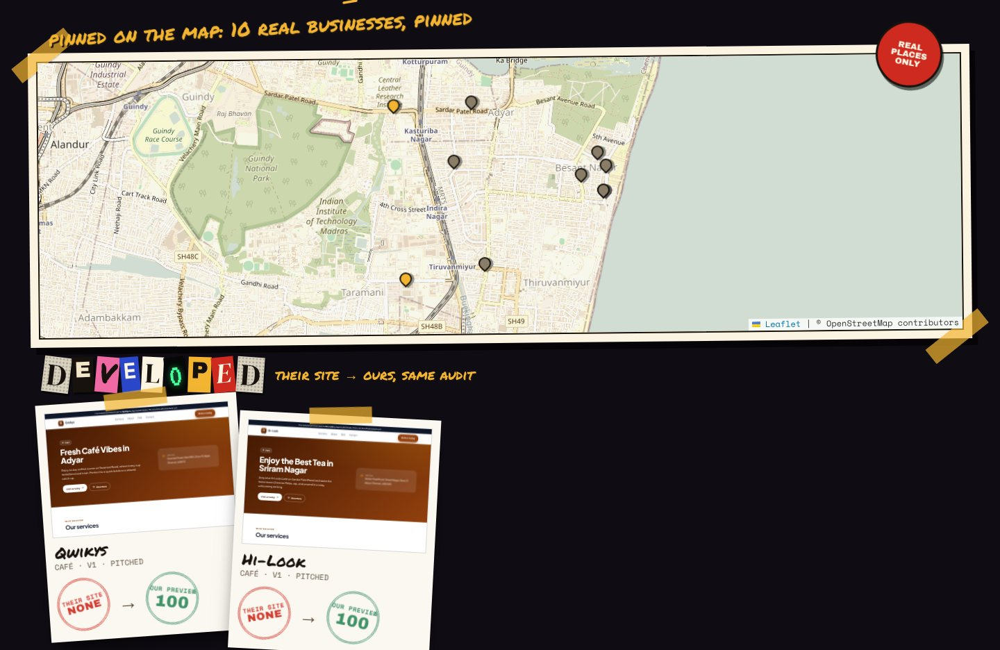 <b>Real places only.</b> Leads are pinned on OpenStreetMap; each built site develops like a polaroid, with their score vs ours.</td>
<td width="50%">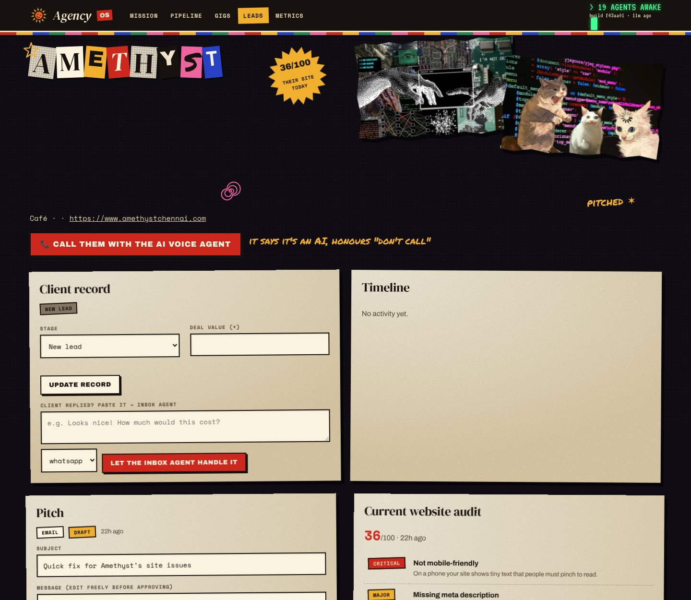 <b>Every client has a record</b>: audit findings, site versions, pitches, and a timeline of everything the agents did.</td>
</tr>
</table>

### From a WhatsApp chat to a quote, a plan and an invoice

<table>
<tr>
<td width="50%">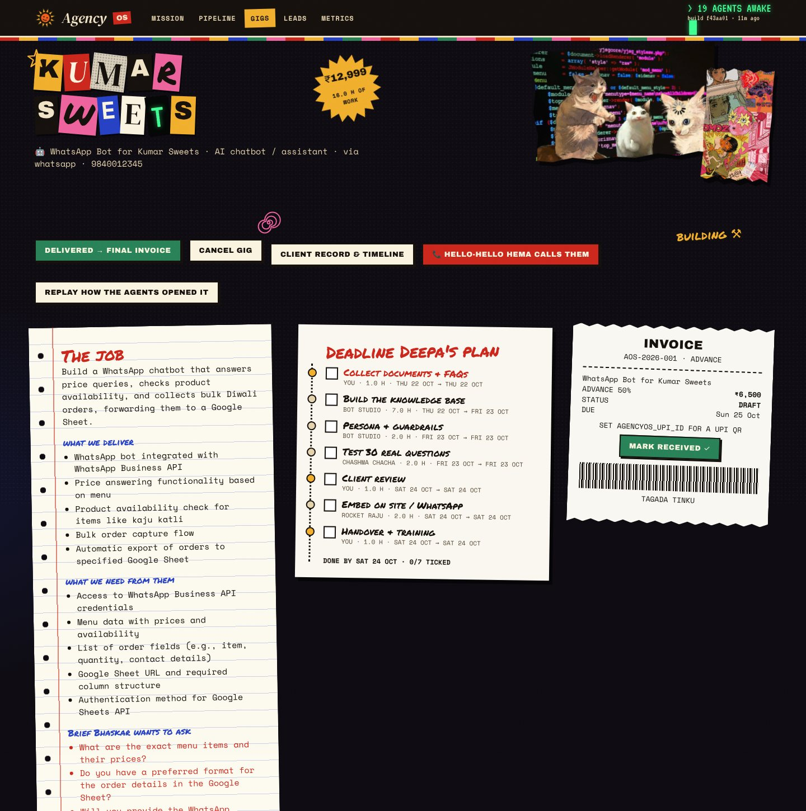 <b>Paste the client's chat.</b> Brief Bhaskar scopes it, Hisaab Hari prices it (the LLM writes words, code writes every number), Deadline Deepa plans it around your other gigs, Tagada Tinku invoices it with a UPI QR.</td>
<td width="50%">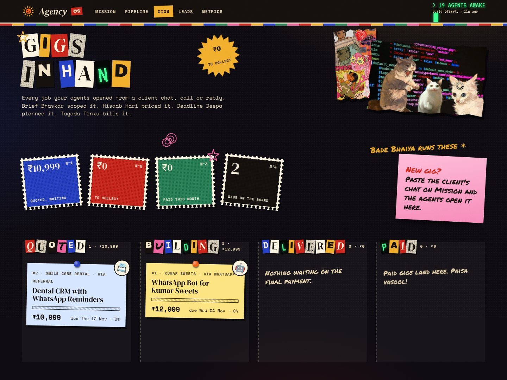 <b>The gigs board.</b> Quoted → Building → Delivered → Paid. When the client replies <i>"go ahead"</i>, the Inbox agent moves the gig and drafts the 50% advance invoice.</td>
</tr>
</table>

### Your day, your CRM, your 200 leads

<table>
<tr>
<td width="50%">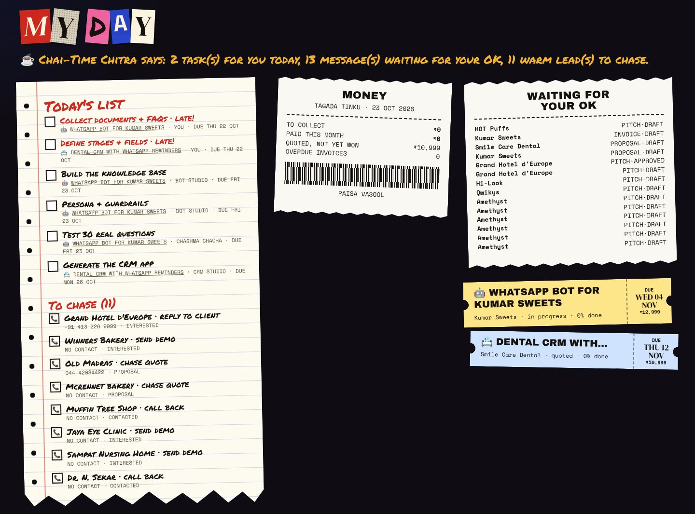 <b>My Day</b> by Chai-Time Chitra: today's tasks, money to collect, payments to confirm, warm leads to chase, messages waiting for your OK.</td>
<td width="50%">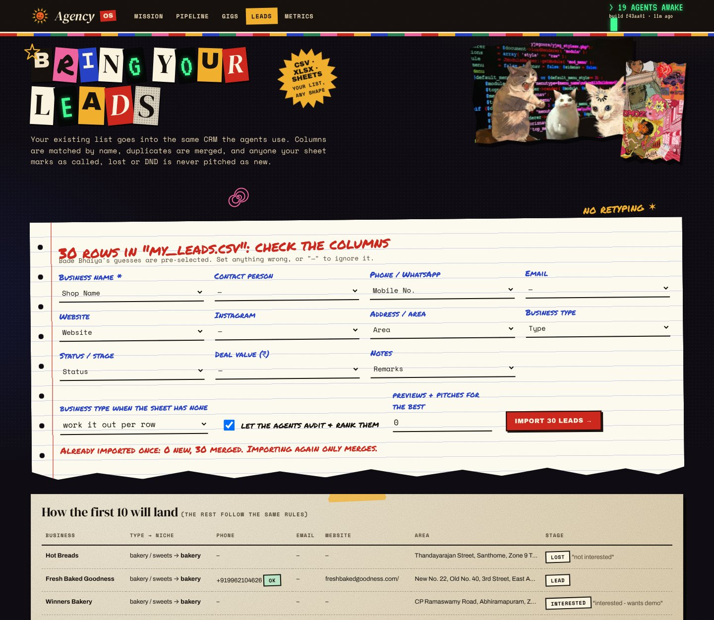 <b>Bring your existing list</b> (CSV, Excel, Google Sheets). Columns are matched by name, duplicates merged, and anyone your sheet marks "called", "lost" or "DND" is never pitched as new.</td>
</tr>
<tr>
<td width="50%">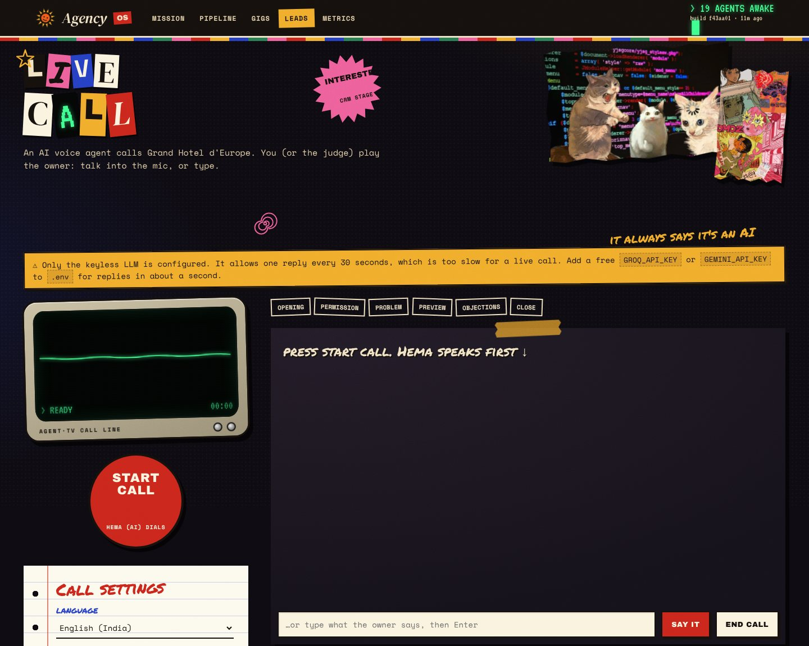 <b>AI calls in a human voice.</b> It always says it's an AI, answers prices only from your price list, and honours "don't call me" instantly.</td>
<td width="50%">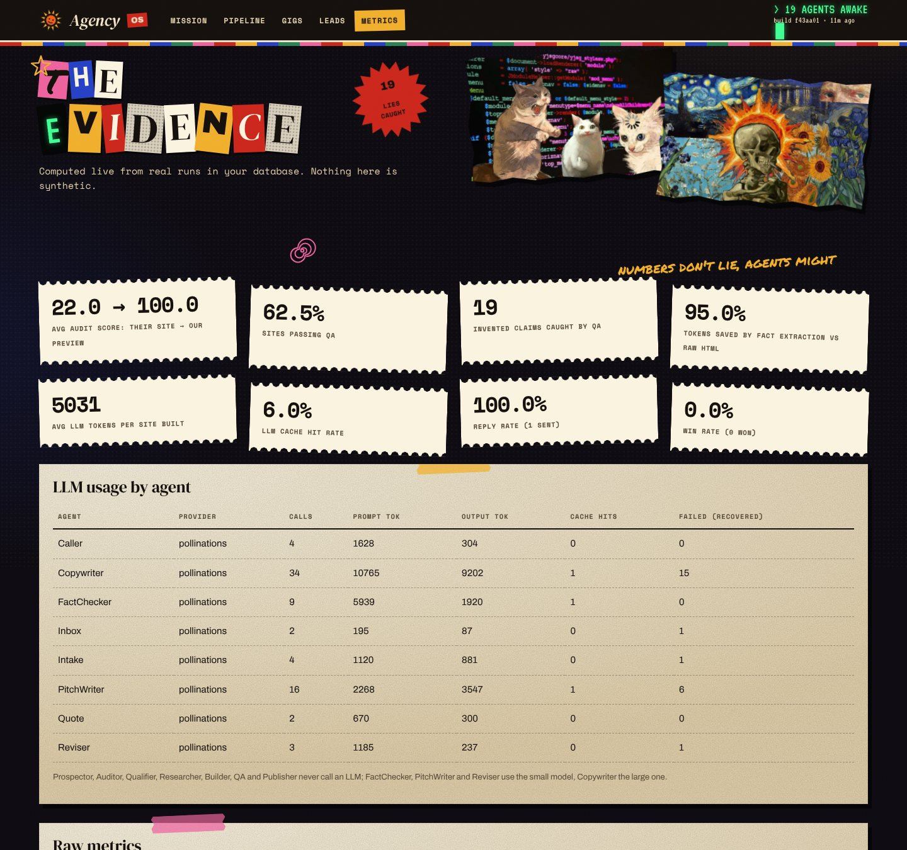 <b>Measured, not claimed.</b> Tokens per site, cache hits, claims caught, old-vs-new scores, reply and win rates, all from real runs.</td>
</tr>
</table>

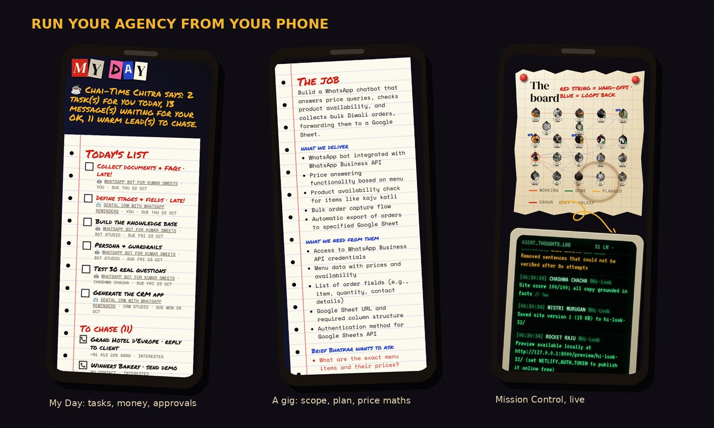

## Meet the agency

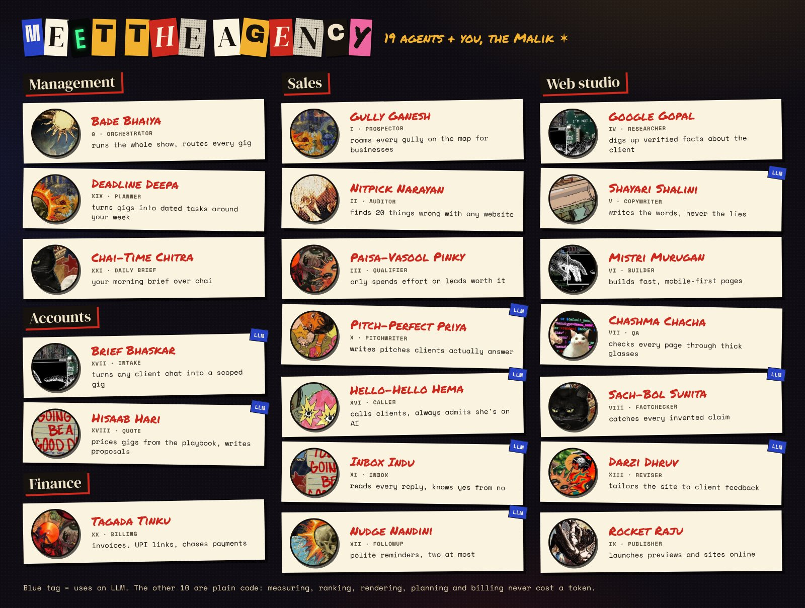

<b>Who does what</b> (click)

| Desk | Agent | Nickname | LLM? |
|---|---|---|:-:|
| Management | Orchestrator | **Bade Bhaiya** runs the whole show | – |
| Management | Planner | **Deadline Deepa** turns gigs into dated tasks around your week | – |
| Management | Daily brief | **Chai-Time Chitra** your morning brief over chai | – |
| Sales | Prospector | **Gully Ganesh** roams every gully on the map | – |
| Sales | Auditor | **Nitpick Narayan** finds 20 things wrong with any website | – |
| Sales | Qualifier | **Paisa-Vasool Pinky** only spends effort on leads worth it | – |
| Sales | PitchWriter | **Pitch-Perfect Priya** writes pitches clients answer | yes |
| Sales | Caller | **Hello-Hello Hema** calls clients, always admits she's an AI | yes |
| Sales | Inbox | **Inbox Indu** reads every reply, knows yes from no | yes |
| Sales | Follow-up | **Nudge Nandini** polite reminders, two at most | yes |
| Accounts | Intake | **Brief Bhaskar** turns any client chat into a scoped gig | yes |
| Accounts | Quote | **Hisaab Hari** prices gigs from the playbook | yes |
| Web studio | Researcher | **Google Gopal** digs up verified facts | – |
| Web studio | Copywriter | **Shayari Shalini** writes the words, never the lies | yes |
| Web studio | Builder | **Mistri Murugan** builds fast, mobile-first pages | – |
| Web studio | QA | **Chashma Chacha** checks every page through thick glasses | – |
| Web studio | Fact-Checker | **Sach-Bol Sunita** catches every invented claim | yes |
| Web studio | Reviser | **Darzi Dhruv** tailors the site to client feedback | yes |
| Web studio | Publisher | **Rocket Raju** launches previews online | – |
| Finance | Billing | **Tagada Tinku** invoices, UPI links, chases payments | – |

## Why you can trust it with your clients

- **Nothing is sent without your OK.** Every message is a draft until you approve it. Do-not-contact is permanent.
- **Numbers come from code, not the model.** Prices, dates, advances, phone numbers and addresses are computed or read from data; a model-written line containing a number the client never said is dropped.
- **Two layers against invented claims.** Rule checks, then an LLM fact-checker whose findings are re-verified in code. *"15 years of experience"* and *"rooftop pool"* never reach a client.
- **Honest calls.** The voice agent says it's an AI in its first line and tells the truth when asked.
- **Every step is traced**: which agent did what, how long it took, how many tokens it cost.

## Cheap by design

| Real run | Tokens |
|---|--:|
| Campaign: 10 real cafés found, audited, ranked, 2 websites built and fact-checked, 2 pitches | **5,208** |
| A client chat turned into a scoped, priced, planned gig with a proposal | **~500–1,100** |
| 30 imported leads audited and ranked, 1 website + pitch built | **1,820** |
| Re-auditing, ranking, planning, invoicing | **0** (plain code) |

Facts, not HTML, go to the model (a 21 KB website became 1,086 characters), only the Copywriter uses a large model,
identical prompts are cached, and per-run and per-day budgets fall back to safe templates instead of failing.
It runs on free tiers (Gemini, Groq, OpenRouter, a local Ollama, or a keyless fallback) with automatic failover.

## Want AgencyOS? Contact me

This repository is the **showcase**; the source code is private. If you'd like AgencyOS, pick what fits and fill in a
short form, or email me directly at **[rohanch0804@gmail.com](mailto:rohanch0804@gmail.com?subject=AgencyOS)**.

| You are | You'd like | |
|---|---|---|
| A **freelancer** or **agency** | to run your client work with AgencyOS, or a live walkthrough | [**Request AgencyOS →**](https://github.com/URK23CS7048Rohan/AGENTS-FOR-FREELANCER--19/issues/new?template=1-get-agencyos.yml) |
| An **evaluator, recruiter or investor** | code access or a demo | [**Request access →**](https://github.com/URK23CS7048Rohan/AGENTS-FOR-FREELANCER--19/issues/new?template=1-get-agencyos.yml) |
| A **business** | a website, AI chatbot, automation, CRM or ML model built for you | [**Hire me →**](https://github.com/URK23CS7048Rohan/AGENTS-FOR-FREELANCER--19/issues/new?template=2-hire-me.yml) |

  
  
  

## How it works

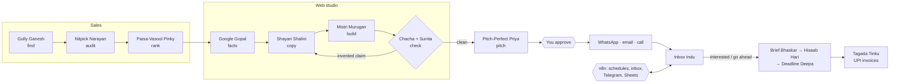

The full story (every agent, the guardrails, token accounting and the evaluation) is in **[docs/HOW-IT-WORKS.md](docs/HOW-IT-WORKS.md)**.

**Stack:** Python · FastAPI · Jinja · SQLite / PostgreSQL · httpx · n8n · OpenStreetMap ·
free LLM tiers through one gateway · 50 automated tests on both databases.

## Roadmap

- [x] Find, audit, rank, build, fact-check, pitch, follow up
- [x] AI voice calls with consent rules
- [x] Gigs: intake, quotes, planning, UPI invoices
- [x] Import existing leads, PostgreSQL, Google/GitHub sign-in, free hosting
- [ ] Studios that ship the other services end to end: RAG chatbots, n8n workflow generator, CRM generator, AutoML
- [ ] Reviews & maintenance agents (testimonial calls, uptime checks, monthly care reports)
- [ ] Learning from pitches that won

## Licence

**© 2026 Rohan. All rights reserved.** This is a showcase of a private project, not open source. The text, images and
designs here may not be copied, reused or redistributed without written permission. See [LICENSE](LICENSE).

## Credits

Built by [Rohan](https://github.com/URK23CS7048Rohan) for freelancers everywhere. Collage artwork is used with the
owners' permission and belongs to them; see [ART-CREDITS.md](ART-CREDITS.md).

<b>If AgencyOS is the agency you wish you had, give it a star, and <a href="https://github.com/URK23CS7048Rohan/AGENTS-FOR-FREELANCER--19/issues/new?template=1-get-agencyos.yml">tell me</a> you want it.</b>

