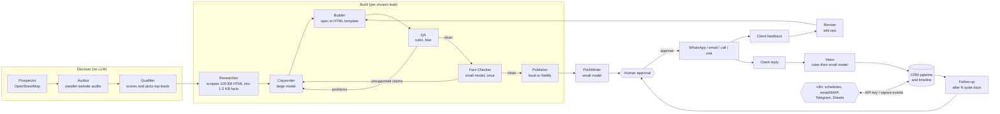
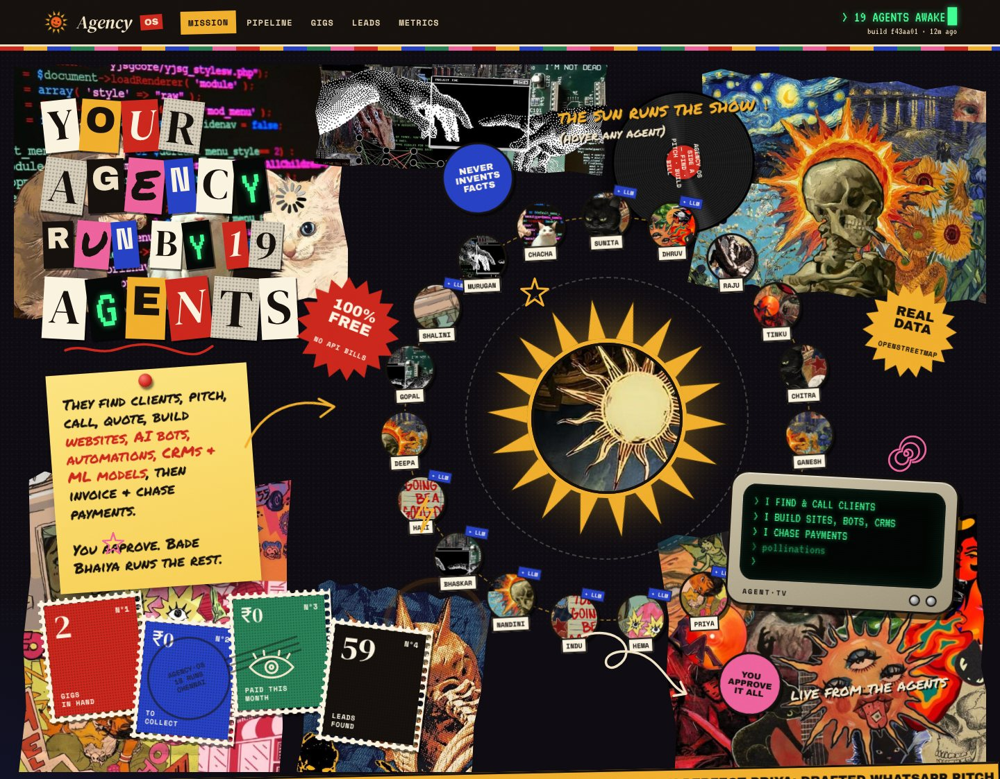
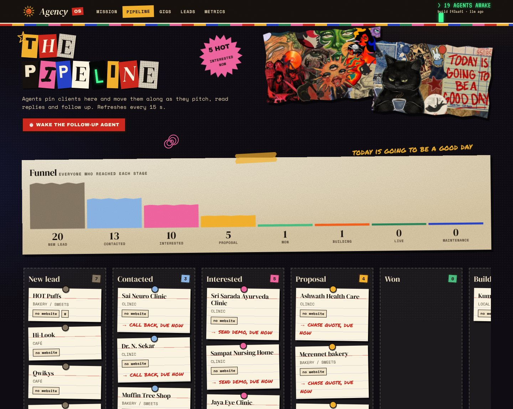
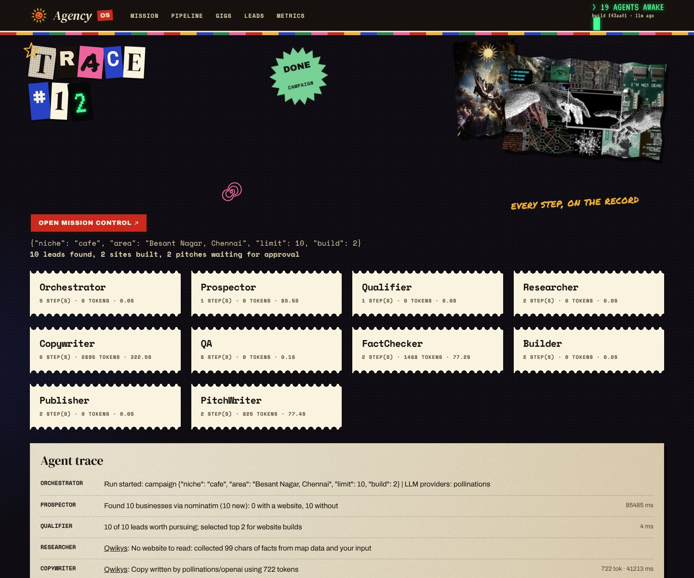

# How AgencyOS works

The deep dive behind the [README](../README.md): architecture, every agent, guardrails, token costs and evaluation.

## Why this needs agents (and not one big prompt)

| Requirement | Why a single LLM call can't do it | How AgencyOS does it |
|---|---|---|
| Work on real businesses | Needs live map data, HTTP, robots.txt, HTML parsing | Tool-using agents (Prospector, Auditor, Researcher) |
| Never lie to a client | LLMs invent "15 years of experience", "insurance accepted", "rooftop pool" | Rule-based QA, then an LLM **Fact-Checker** whose findings are themselves verified in code, then targeted rewrites |
| Spend money only on likely buyers | Can't know which leads matter before measuring them | **Qualifier** ranks leads with cheap measurements first |
| Stay within free-tier limits | Rate limits, outages, reasoning models that return nothing | **LLM gateway** with failover, pacing, caching, budgets and safe template fallbacks |
| Revise safely | Free-form LLM HTML edits break pages and can change phone numbers | **Reviser** emits a whitelisted list of edit operations; facts are read-only |
| Keep a human in charge | Outreach is reputational and legal risk | Approval gate, do-not-contact list, daily email cap, opt-out line |

## Architecture

Every agent has a nickname on the dashboard and in the live log: Bade Bhaiya (Orchestrator), Gully Ganesh (Prospector),
Nitpick Narayan (Auditor), Paisa-Vasool Pinky (Qualifier), Google Gopal (Researcher), Shayari Shalini (Copywriter),
Mistri Murugan (Builder), Chashma Chacha (QA), Sach-Bol Sunita (Fact-Checker), Rocket Raju (Publisher),
Pitch-Perfect Priya (PitchWriter), Darzi Dhruv (Reviser), Inbox Indu (Inbox), Nudge Nandini (Follow-up),
Hello-Hello Hema (Caller), Brief Bhaskar (Intake), Hisaab Hari (Quote), Deadline Deepa (Planner), Tagada Tinku (Billing),
Chai-Time Chitra (Daily brief) and Jyotishi Jagan, the LLM oracle. 

| Agent | Uses LLM? | Job |
|---|---|---|
| Orchestrator | no | Plans the pipeline, runs audits in parallel, owns the reflection loop, closes every run |
| Prospector | no | Finds businesses (Overpass API with mirror failover, Nominatim fallback), de-duplicates |
| Auditor | no | 20 measured checks: HTTPS, response time, viewport, title/description, tap-to-call, stale "© 2016" footers, old jQuery/WordPress, broken links, structured data… plus optional Google PageSpeed |
| Qualifier | no | Opportunity score from need (no site / down / audit score) and reachability; skips good sites and businesses already pitched |
| Researcher | no | Respects robots.txt, reads homepage plus about/services pages, extracts phones, emails, services, hours, brand colour, photos |
| Copywriter | **large** | Writes headline, services, about, FAQ and SEO text as JSON, from facts only; `fix()` rewrites only the flagged fields |
| Builder | no | Renders a fast, accessible, mobile-first page (JSON-LD, Open Graph, tap-to-call, WhatsApp, map, opening hours) from a JSON spec |
| QA | no | Runs the Auditor's own checks on our page, and catches invented numbers, boasts, policies and placeholders |
| Fact-Checker | small | LLM critic that quotes unsupported claims. Each claim is double-checked against the facts in code, so its false alarms are overruled |
| Publisher | no | Deploys the preview to free Netlify hosting, or serves it locally |
| PitchWriter | small | Picks a channel (WhatsApp for mobiles, email, call script or walk-in script) and writes a pitch quoting measured problems |
| Reviser | small | Turns client feedback into validated edit operations (`set_text`, `set_palette`, `hide_section`, `add_service`…) |
| Inbox | small (rules first) | Classifies replies (interested, question, not interested, STOP). STOP and "not interested" are handled by rules, without an LLM. Updates the CRM and drafts a response |
| Follow-up | small | Drafts at most `MAX_FOLLOWUPS` polite nudges after `FOLLOWUP_DAYS` of silence, then marks the lead lost |
| **Caller** | small (rules first) | A **voice sales agent**. It talks to the owner turn by turn through a staged script (opening → permission → problem → preview → objections → close) and acts mid-call (send the preview, book a callback, mark interest, block the number). Afterwards it writes a summary to the CRM |
| **Intake** | small | Turns a client chat into a gig spec. Budget and deadline come from code-level parsing of the client's words; an LLM value survives only if it appears in the brief |
| **Quote** | small | Prices from the service playbook. The LLM writes greeting, scope bullets and questions; a model-written line with a number the client never said is dropped |
| **Planner** | no | Capacity-aware scheduling across all open gigs; marks gigs at risk |
| **Billing** | no | Numbered invoices (`AOS-2026-001`), UPI deep link + QR, advance on yes, balance on delivery. Money messages are templates, so an amount can never be hallucinated |
| Daily brief | no | Pure queries: tasks, deadlines, money, approvals |

## Voice calls (the Caller agent)

Open any lead and press **📞 Call them with the AI voice agent**. The call console runs in Chrome or Edge.
The browser speaks the agent's lines in a natural voice and listens through the microphone; you can also type.
You, or the judge, play the business owner. English, Tamil and Hindi are selectable.

Some things are hard-coded in code and never left to the LLM:
* **The opener always says it's an AI** ("I'm Asha, an AI assistant calling on behalf of…").
* **"Don't call me"** ends the call and blocks the number.
* **"Are you a robot?"** always gets a truthful answer.
* **"How much?"** is answered from your `PRICE_TIERS` and nothing else. Any other price the model says is cut out before it's spoken.
* The preview is sent only when the owner **asks for it on the call**. That counts as their consent, and the message is queued through the normal approval path, so n8n can deliver it.

Real phone calls aren't included. In India, unsolicited commercial calls must respect TRAI's Do-Not-Disturb rules, and in
the US, AI-voice calls fall under robocall consent rules. A telephony provider (for example Twilio) can be plugged into the same
`/api/calls` endpoints for leads who opted in or asked for a callback. Note that a live call needs a fast LLM
(free Groq or Gemini key); the keyless fallback allows only one reply per 30 seconds.

## Mission Control, CRM and n8n

<table><tr>
<td width="50%"> The CRM pipeline, stage by stage.</td>
<td width="50%"> The text trace of a run: every step, its agent, time and tokens.</td>
</tr></table>

The dashboard is designed as a cut-and-paste **zine**: Renaissance and Van Gogh collages, halftone, risograph inks,
tape, receipts and a green-phosphor terminal. Every agent has a disc cut from the artwork and a nickname.
Artwork is used with permission; see [ART-CREDITS.md](../ART-CREDITS.md).

* **Mission Control** (`/runs/<id>/live`): every agent is a node that pulses while it works, turns green, amber or red when it finishes, and passes animated "data packets" to the next agent, including the QA and Fact-Checker loops back to the Copywriter. The LLM gateway node lights up on every model call, showing the provider, tokens and cache hits. Alongside it are a typed-out thought stream, a live map of real leads, old-vs-new score rings with live site thumbnails, and **Replay at 5, 10 or 25×** for demos.
* **Pipeline board** (`/pipeline`): clients move through New lead → Contacted → Interested → Proposal → Won → Building → Live → Maintenance, with a funnel chart. Each lead has a full **timeline** of messages, stage changes, site versions and approvals.
* **n8n**: five workflows (daily prospecting, a signed event router, inbound replies, follow-ups and Google Sheets sync) handle schedules, the inbox, Telegram alerts and Google Sheets.

## Token-saving design

Measured on real runs during development:

* **Facts, not HTML.** The Researcher compressed a real 21 KB café website into 1,086 characters (**95% fewer tokens**) before any LLM saw it.
* **10 of 19 agents never call an LLM.** Measuring, ranking, rendering, QA, publishing, planning and billing are code.
* **The LLM writes words, never markup.** The Builder renders HTML from a JSON spec. Output tokens stay small and pages are always valid.
* **Targeted repair.** QA problems trigger a rewrite of only the failing fields (`ContentPatch`), not the whole site.
* **One LLM critic call per site.** Later rounds re-check the critic's quotes in code.
* **Model routing.** Only the Copywriter uses the large model; everything else uses the small one.
* **Response cache.** Identical prompts are free; a rebuild with unchanged facts costs 0 tokens.
* **Budgets.** There is a per-run and a per-day token budget. When spent, agents fall back to safe templates instead of failing.
* **Provider tuning.** `reasoning_effort=low` on the keyless provider cut its prompt overhead from 317 to 108 tokens and stopped it spending the whole allowance on reasoning.
* **Bounded cost.** A full redesign with fact-check and one fix round took about **4 LLM calls and roughly 3.9k tokens**. A no-website lead took about **1.6k tokens** for copy.

## Guardrails

* **Facts are read-only.** Phone numbers, addresses and hours come from data, never from the LLM. The Reviser can't edit them.
* **Two-layer hallucination defence.** Regex rules for numbers, boasts and policies, then the LLM Fact-Checker, which is in turn verified against the facts. Anything still unverifiable after 2 fix rounds is removed sentence by sentence.
* **Previews are honest.** Every preview has a visible banner ("Free preview made for X by Y, not the official website") and `noindex`.
* **Outreach is human-approved.** Pitches are drafts until you approve them. There is a do-not-contact list, a daily email cap, and an opt-out line in emails. Businesses already pitched are never pitched again.
* **Polite scraping.** robots.txt is respected, requests are rate-limited (Nominatim 1/s) and the user agent is descriptive.
* **Every action is traced.** Each agent step is stored with timing and token cost, and shown in the dashboard.

## Evaluation (live from your own runs)

`/metrics` in the dashboard computes from the database:

* **Quality:** average audit score of the business's site against our preview, QA pass rate, claims caught, sentences removed, template fallbacks.
* **Cost:** LLM calls, tokens per site, cache hit rate, failed calls recovered by failover, HTML-to-facts compression.
* **Business outcome:** pitches drafted, approved, sent, replied and won, with reply and win rates. This comes from real outreach that you mark in the dashboard.

Example from development: a real Chennai café website scored **36/100** (not mobile-friendly, no meta
description, no tap-to-call…). AgencyOS's preview for it scored **100/100** on the same checks.

## Known limits and next steps

* OpenStreetMap in India often lacks phone numbers. Those leads get a walk-in pitch script, or you can add details manually.
* The keyless LLM is slow. A free Gemini or Groq key makes a full build take seconds instead of minutes.
* Next steps: a content-collection agent that chases clients for logos and photos on WhatsApp, a one-click "go live" on the client's domain, and learning from pitches that won (few-shot examples chosen by reply rate).

